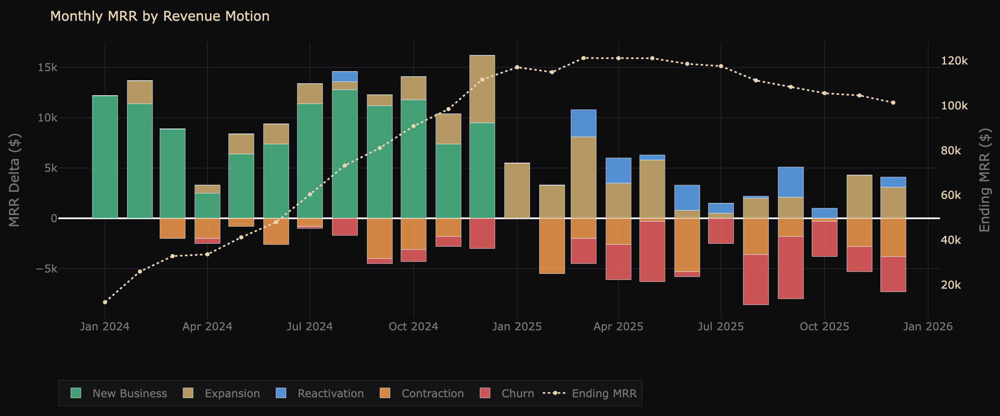
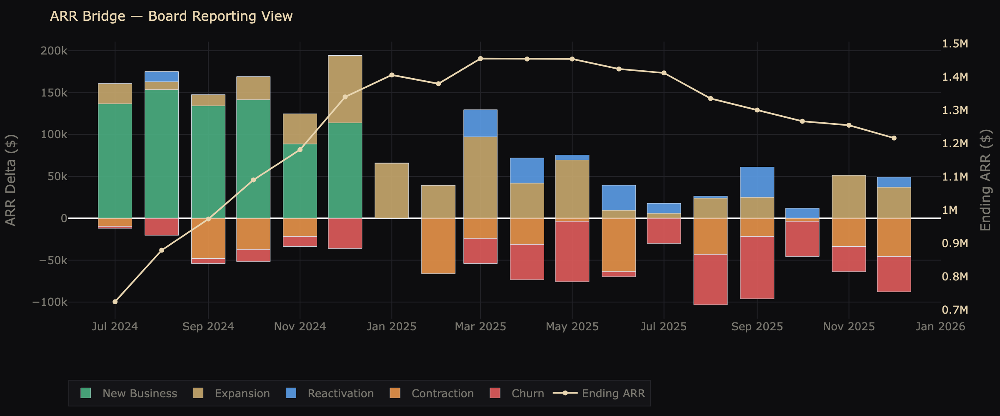
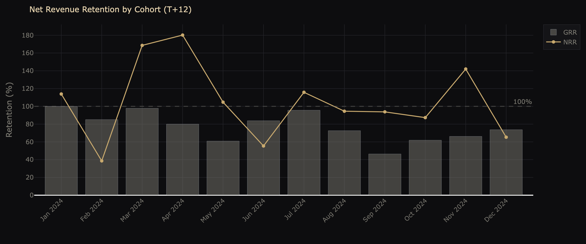
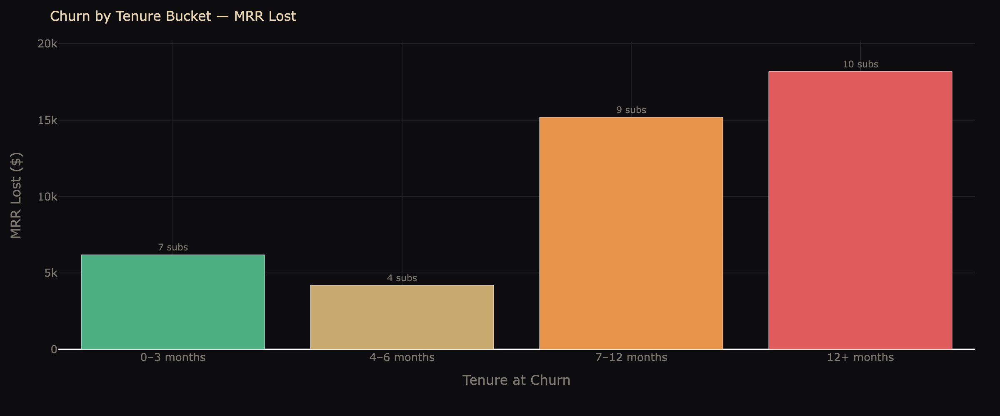

# GTM Revenue Analytics Platform

Production-grade SaaS revenue modeling on dbt + DuckDB + Streamlit.

MRR waterfall · NRR cohort analysis · ARR bridge · Churn by tenure · all from a single event log.


---

## The problem this solves

Most analytics teams have *some* version of a revenue dashboard. Almost none of them agree on the numbers.

Ask five people in your company what your NRR is and you'll get five answers. Ask where the number comes from and you'll find:
- a spreadsheet someone built two years ago
- a Tableau calculated field that's slightly different
- a dbt model that hasn't been updated since the pricing changed
- an analyst who runs a query from memory and formats it manually each month

The root cause is almost never bad data. It is **undefined business logic** — no single, documented, tested definition of what "churn" means, what counts as "expansion", whether reactivations go into NRR or not.

This project builds that definition layer in dbt and makes it explicit, testable, and auditable.

---

## Dashboard

**MRR Waterfall** — monthly revenue motion by type, with cumulative ending MRR overlay



**ARR Bridge** — period-over-period ARR decomposition in board reporting format



**NRR Cohort Analysis** — net and gross revenue retention by cohort (T+12)



**Churn Analysis** — churn events by tenure bucket, with MRR impact



---

## What's here

```
gtm-revenue-analytics/
├── data/
│   ├── generate_data.py          # synthetic data generator (100 accounts, 24 months)
│   └── generate_screenshots.py   # static chart exports for README/docs
├── dbt/
│   ├── seeds/                    # source data: accounts, subscriptions, events
│   ├── tests/
│   │   └── assert_mrr_invariant.sql  # custom test: ending MRR = cumulative sum
│   └── models/
│       ├── staging/              # type-cast and rename raw source fields
│       │   ├── stg_accounts.sql
│       │   ├── stg_subscriptions.sql
│       │   └── stg_subscription_events.sql
│       ├── intermediate/         # business logic: one place, documented, tested
│       │   ├── int_mrr_movements.sql   ← the core model
│       │   └── int_customer_cohorts.sql
│       └── marts/                # reporting layer: one row = one answer to one question
│           ├── fct_mrr.sql             ← monthly waterfall
│           ├── fct_nrr.sql             ← NRR and GRR by cohort (T+12)
│           ├── fct_churn.sql           ← churn events with tenure analysis
│           ├── dim_customer.sql        ← current customer state
│           └── rpt_arr_bridge.sql      ← ARR bridge for board reporting
├── app/
│   └── streamlit_app.py          # interactive dashboard
├── docs/
│   ├── adr-001-mrr-movement-classification.md
│   └── screenshots/
├── .github/workflows/ci.yml      # dbt test on every push
├── Makefile
├── CHANGELOG.md
└── requirements.txt
```

---

## Architecture

```
   Raw Sources (seeds)
   ┌──────────────────────────────────────────┐
   │  accounts.csv  subscriptions.csv         │
   │  subscription_events.csv                 │
   └──────────────────────────────────────────┘
                      │
                      ▼
   Staging (views)
   ┌──────────────────────────────────────────┐
   │  Type-cast · rename · no business logic  │
   └──────────────────────────────────────────┘
                      │
                      ▼
   Intermediate (tables)
   ┌──────────────────────────────────────────┐
   │  int_mrr_movements                       │
   │    event → movement_type + mrr_delta     │
   │    new_business / expansion / contraction│
   │    churn / reactivation                  │
   │  int_customer_cohorts                    │
   │    subscription → cohort_month           │
   └──────────────────────────────────────────┘
                      │
                      ▼
   Marts (tables)
   ┌──────────────────────────────────────────┐
   │  fct_mrr        monthly waterfall        │
   │  fct_nrr        NRR + GRR by cohort      │
   │  fct_churn      churn tenure analysis    │
   │  dim_customer   current customer state   │
   │  rpt_arr_bridge ARR bridge (board view)  │
   └──────────────────────────────────────────┘
                      │
                      ▼
   Streamlit Dashboard
```

The key design choice: **`int_mrr_movements` is the single source of truth** for all revenue motion logic. Every mart model reads from it. No mart re-derives movement types. When a definition changes, you change it in one place.

---

## Design decisions

**1. Event-based vs snapshot-based**

Snapshot-based MRR calculation compares subscription state at the start and end of each month. The problem: if a customer churns and reactivates within the same month, snapshots show no change. The event log shows both the churn and the reactivation as separate, correctly classified revenue motions.

**2. DuckDB over PostgreSQL**

No infrastructure required. The entire pipeline runs locally on a single `.duckdb` file. Anyone can clone the repo and run `make all` without setting up a database. The dbt models are standard SQL and port to any warehouse (Snowflake, BigQuery, Redshift) by changing the profile.

**3. Single subscription per account**

Production systems often have multiple subscriptions per account (seats, add-ons, billing frequency variants). This project assumes one subscription per account to keep the cohort logic clean and the dataset readable. The assumption is documented in `int_customer_cohorts.sql` and in [ADR-001](docs/adr-001-mrr-movement-classification.md).

**4. Reactivation included in NRR**

A reactivated customer is still a customer from the original cohort — they left and came back. Excluding reactivations from NRR would understate retention and differs from how most investors calculate it. GRR (which excludes expansion entirely) is also computed as a conservative benchmark. Both are in `fct_nrr`.

---

## Revenue motion definitions

See [ADR-001](docs/adr-001-mrr-movement-classification.md) for the full reasoning. The short version:

| Motion | What it means | MRR delta |
|---|---|---|
| **new_business** | First MRR from this subscription | `+ new_mrr` |
| **expansion** | MRR increased on an existing subscription | `+ (new - old)` |
| **contraction** | MRR decreased, still active | `- (old - new)` |
| **churn** | Subscription cancelled | `- old_mrr` |
| **reactivation** | Previously churned subscription restarted | `+ new_mrr` |

---

## Key results (synthetic dataset)

| Metric | Value |
|---|---|
| Accounts | 100 |
| Period | Jan 2024 – Dec 2025 (24 months) |
| Ending MRR | ~$101k |
| ARR at period end | ~$1.2M |
| Active accounts at end | 82 of 100 |
| Avg months to churn | ~8 months |
| dbt models | 10 (3 staging, 2 intermediate, 5 marts) |
| dbt tests | 36 (including MRR invariant test) |

---

## Quick start

```bash
# Set up a virtual environment (recommended)
python3 -m venv .venv && source .venv/bin/activate

# Install dependencies
pip install -r requirements.txt

# Generate synthetic data and build the full pipeline
make all

# Or step by step:
python3 data/generate_data.py          # generates seed CSVs
cd dbt && dbt deps && dbt seed && dbt run && dbt test
cd ..

# Launch the dashboard
python3 -m streamlit run app/streamlit_app.py

# Generate static chart screenshots
python3 data/generate_screenshots.py
```

The pipeline creates a local `gtm_revenue.duckdb` file. No external database required.

---

## Tests

```bash
cd dbt && dbt test
```

36 tests: uniqueness, not-null, accepted values, referential integrity, and the MRR invariant.

The MRR invariant test (`tests/assert_mrr_invariant.sql`) verifies automatically:
```sql
-- For every month: ending MRR stored in fct_mrr = running sum of all mrr_delta
-- Returns rows when violated — zero rows means the invariant holds
```

---

## Taking it to production

Replace the `dbt/seeds/` data with `dbt/sources/` pointing to your warehouse:

```yaml
# dbt/models/staging/sources.yml
sources:
  - name: chargebee
    tables:
      - name: subscription_events   # Chargebee event stream → warehouse
  - name: salesforce
    tables:
      - name: account               # Salesforce Account → warehouse
```

The staging, intermediate, and mart models are unchanged — they operate on the same column contracts. Add Airflow or dbt Cloud for scheduling. The business logic layer (`int_mrr_movements`) is the asset; the data source is just plumbing.

---

*Part of the [goldlayer.dev](https://goldlayer.dev) portfolio.*
